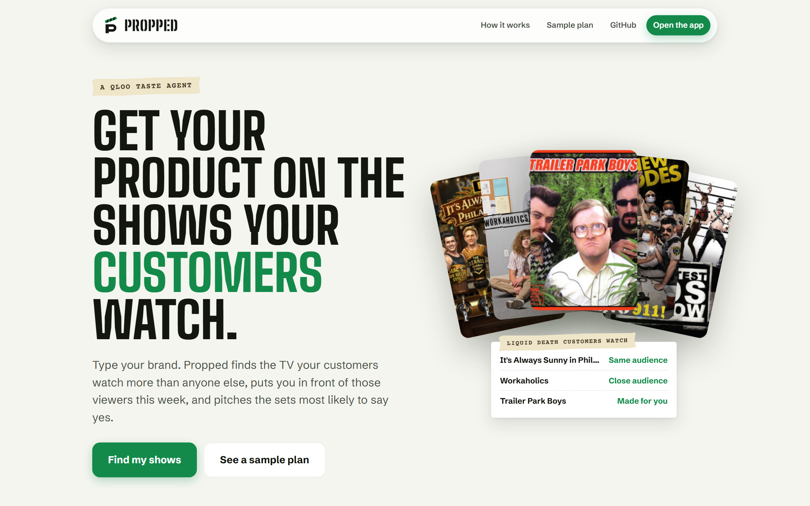
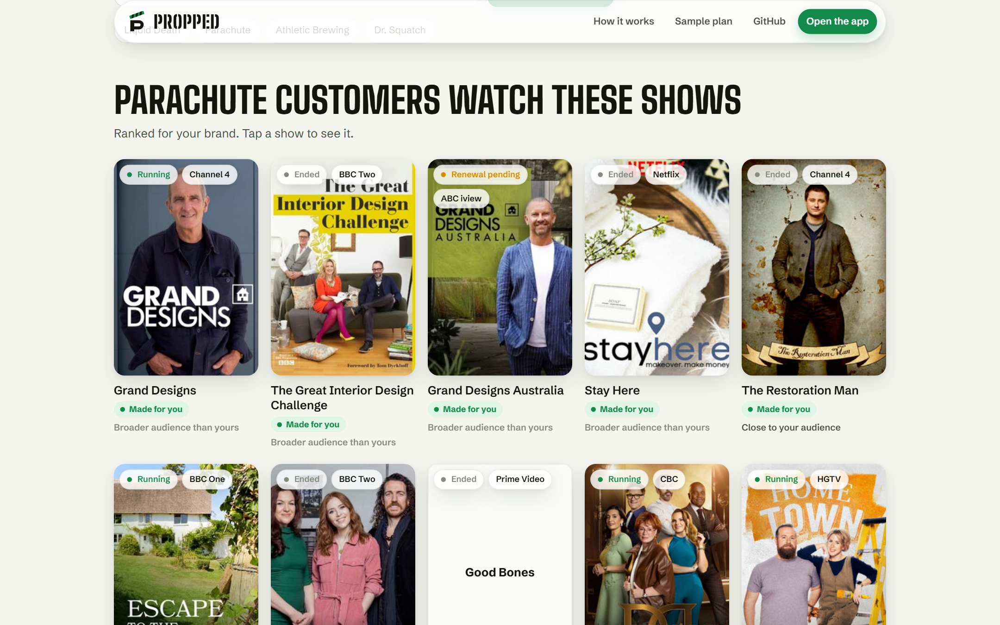
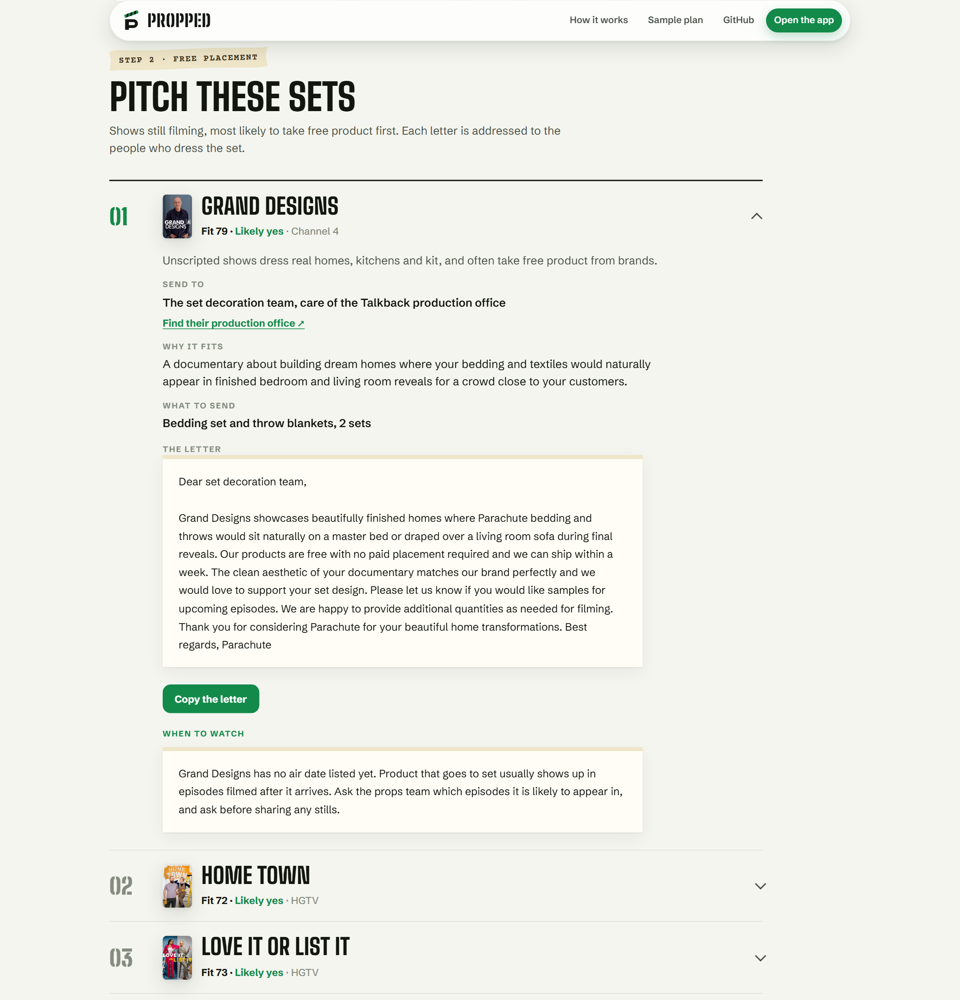
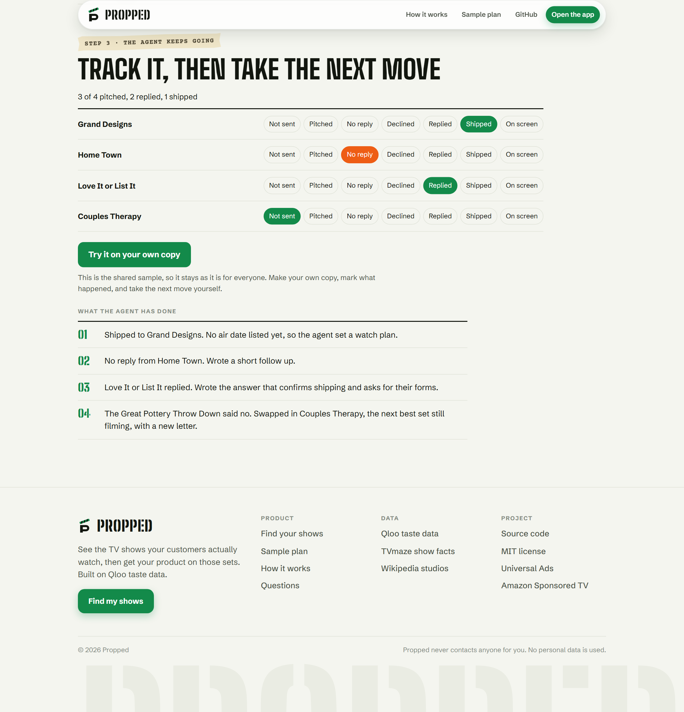

<p align="center">
  
</p>

<h1 align="center">Propped</h1>

<p align="center">
  <b>Get your product on the TV shows your customers watch.</b><br>
  Type your brand. Propped finds the shows your customers love, puts you in front of those viewers this week, and pitches the sets most likely to say yes. Then the agent keeps working until you are on screen.
</p>

<p align="center">
  <a href="https://propped-alpha.vercel.app"></a>
  <a href="https://youtu.be/ocyj1M-hTus"></a>
  <a href="https://propped-alpha.vercel.app/plan/parachute-fs150"></a>
  <a href="https://github.com/jenzylove/propped/actions/workflows/verify.yml"></a>
  <a href="https://qloo.devpost.com"></a>
  <a href="LICENSE"></a>
</p>

<p align="center">
  
</p>

Every kitchen counter, bar fridge and bedside table on TV is dressed by a props team, and most of what
they use comes free from brands that asked. The hard part for a small brand was never the cost. It is
knowing which shows its own customers watch, and that answer lives in audience research a founder
can't buy.

Propped is that research, turned into action.

| | |
|---|---|
| Live site | https://propped-alpha.vercel.app |
| Demo video (1:58) | https://youtu.be/ocyj1M-hTus |
| Sample plan, with the agent's moves | https://propped-alpha.vercel.app/plan/parachute-fs150 |
| Try your own brand | https://propped-alpha.vercel.app/app |
| Every step and rule | https://propped-alpha.vercel.app/method |
| Security | [SECURITY.md](SECURITY.md) |

---

## What you get

**1. The shows your customers watch.** Qloo returns the TV shows people who love your brand watch far
more than everyone else. Propped ranks them for your brand, pushing down the shows every brand gets, and
shows each one's status, network and how close its audience is to your customers.

<p align="center">
  
</p>

**2. On TV this week.** The exact choices for a self serve TV campaign aimed at those same viewers: their
ages, the genres and networks they watch, a starter budget from $100 on Universal Ads.

**3. The sets that will say yes.** The agent looks at every show your customers watch that is still
filming, gives each a fit score out of 100, and writes a letter to the people who dress the set, care of
the production company, with what to send.

<p align="center">
  
</p>

**4. The agent keeps going.** Mark each show on the pitch board and take the next move. A no gets the
best fitting replacement set and a new letter. Silence gets a follow up. A reply gets an answer that
confirms shipping and asks for the production's forms. Shipped product gets a watch plan from the real
air dates. Every move is logged on the plan.

<p align="center">
  
</p>

## How it works

```mermaid
flowchart LR
    B[Your brand] --> Q[Qloo<br/>shows your customers love<br/>+ who those viewers are]
    Q --> R[Ranked for your brand<br/>shows every brand gets pushed down]
    R --> T[TVmaze<br/>still filming, network, air dates]
    T --> W[Wikipedia + TVmaze crew<br/>who makes each show]
    W --> A[Agent<br/>picks sets, writes letters,<br/>plans the TV campaign]
    A --> P[Plan + pitch board]
    P -- declined, no reply,<br/>replied, shipped --> N[Next move<br/>swap, follow up, answer, watch plan]
    N --> P
```



| Step | Source |
|---|---|
| Brand lookup | Qloo search, matched strictly to the name you typed |
| Shows the brand's customers watch | Qloo insights, brand to TV show affinity, top 50 |
| Age and gender lean of the brand and of each show | Qloo demographics |
| Ranking for the brand | Specificity weight measured against 39 reference brands |
| Still filming, network, posters, air dates | TVmaze, with a new episode scheduled or one aired in the last 18 months |
| Production company and set crew | Wikipedia and TVmaze crew lists |
| Choices and words | The agent, through tools; every fact comes from the sources above |

Rules live in code, not in the prompt:

- Only live action shows still filming can be pitched, and never shows on the BBC or PBS, which take no
  product placement.
- Big scripted network shows rarely take an unknown brand for free, so they are refused while realistic
  sets exist.
- The fit score is up to 40 points for Qloo's ranking, 30 for how close the audience is, and 30 for how
  realistic a free placement is.
- The ad plan only uses genres and networks from the brand's own results, and skips networks that sell no ads.
- Propped writes letters and settings. It never sends anything or contacts anyone for you.

## Why Qloo

Propped only works because Qloo knows what people who love one thing also love, across brands and TV. A
general model has no access to this audience data and declines to name the shows a brand's customers
watch. Qloo answers it in seconds, and every letter, rating and ad setting rests on that answer.

## Run it locally

```bash
git clone https://github.com/jenzylove/propped
cd propped
npm install
cp .env.example .env   # add your Qloo key and a language model endpoint
npm run dev            # http://localhost:3000
npm test               # 48 tests
```

Saved plans and pitch boards need a Vercel Blob token (`BLOB_READ_WRITE_TOKEN`).

## Project layout

```
src/lib/qloo.ts        Qloo client: search, insights, demographics
src/lib/shows.ts       brand to ranked, enriched shows
src/lib/core/rank.ts   specificity ranking and audience match
src/lib/placement.ts   still filming, placement chance, fit score, recipients
src/lib/plan.ts        the planning agent and its tools
src/lib/next.ts        the next move agent that acts on the pitch board
src/lib/store.ts       versioned plan and board storage
src/app/               landing page, /app, /plan, /method and the API routes
test/                  unit tests for the rules above
```

## Built with

Qloo, TVmaze, Wikipedia and Wikidata, Next.js 15, TypeScript, Vercel and Vercel Blob, Vitest.

## License

[MIT](LICENSE)
