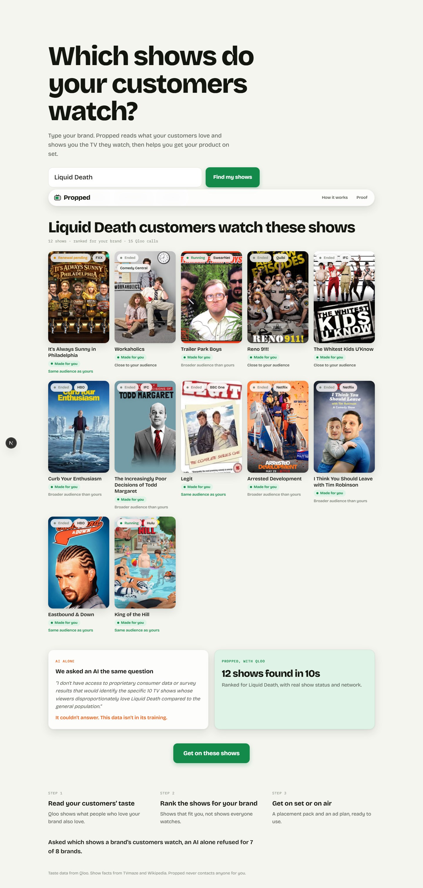
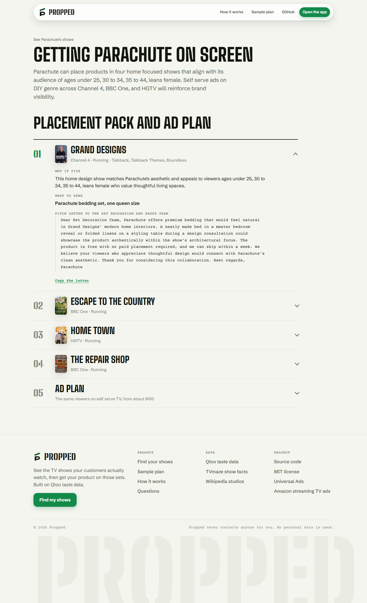

<p align="center">
  
</p>

<h1 align="center">Propped</h1>

<p align="center"><b>See the TV shows your customers actually watch, then get your product on those sets.</b></p>

<p align="center">
  <a href="https://propped-alpha.vercel.app"></a>
  
  
  
</p>

<p align="center">
  
</p>

## Start here

| You want to | Go to |
| --- | --- |
| Try it in ten seconds | [propped-alpha.vercel.app/app](https://propped-alpha.vercel.app/app) and tap **Parachute** |
| See a full placement pack | [Sample plan for Parachute](https://propped-alpha.vercel.app/plan/parachute-v4xnq), or tap **Get on these shows** after any search |
| Understand each step | [How it works](https://propped-alpha.vercel.app/method) |
| Run it yourself | [Run locally](#run-locally) |

## The problem

Getting your product on a TV set is mostly free. Prop and set decoration teams take products at no cost every week. What a small brand doesn't know is **which shows**. That answer lives in audience research a founder can't buy, so they guess, or they pay an agency.

## What Propped does

1. **Type your brand.** Propped asks Qloo which TV shows people who love your brand watch far more than everyone else.
2. **See your shows, ranked for you.** Shows every brand gets (the big sitcoms) are pushed down, so the list fits your brand and not the whole country. Each show gets its live status, network, poster and how close its audience is to yours.
3. **Be on TV this week.** The exact settings for a self serve TV campaign aimed at the same viewers (ages, genres, networks, a $100 starter budget), ready to paste into Universal Ads.
4. **Pitch the sets that will say yes.** The agent checks every show your customers watch that is still filming, rates how likely each is to take free product, and writes a letter to the people who dress the set, care of the production company, with what to send. Copy it or tap Email it.
5. **Track every pitch.** A pitch board on the plan's link: pitched, replied, shipped, on screen.

<p align="center">
  
</p>

## Why Qloo

Propped only works because Qloo knows what people love across brands and TV. Ask a general AI which shows a brand's customers watch and it declines, because that is audience research it was never given. Qloo answers it for most brands in seconds.

| Step | Source |
| --- | --- |
| Brand lookup | Qloo search |
| Shows the brand's customers watch | Qloo insights, brand to TV show affinity |
| Audience age and gender for brand and each show | Qloo demographics |
| Show status, network, poster | TVmaze |
| Production company | Wikipedia |
| Placement choices, pitch letters, ad plan | Agent with tools; every fact comes from the data above |

The agent can only pick shows that are still filming and live action, and can only choose genres and networks that are in the brand's own results. Self serve TV platforms sell genres and audiences, not single shows, and the ad plan says so.

## Run locally

```bash
git clone https://github.com/jenzylove/propped
cd propped
npm install
cp .env.example .env   # add your Qloo key and a language model endpoint
npm run dev
npm test
```

Saved plan links need a Vercel Blob token (`BLOB_READ_WRITE_TOKEN`).

## Built with

Next.js 15, TypeScript, Qloo, TVmaze, Wikipedia, Vercel and Vercel Blob, Vitest.

## License

[MIT](LICENSE)
